# Format-AnsiException

Renders an `ErrorRecord` or `Exception`: type and message, where it happened,
stack frames with the path and line number picked out, and inner exceptions
nested one level each.

## Synopsis

```powershell
Format-AnsiException [-Exception] <object> | Out-AnsiHost
                   [-Detail <Short|Default|Full>]
                   [-ShowStackTrace]
                   [-MaxFrames <int>]
                   [-MessageColor <string>] [-TypeColor <string>]
                   [-PathColor <string>] [-LineNumberColor <string>]
                   [-FrameColor <string>]
                   [-Indent <int>]
                   [-MaxWidth <int>]        # -Width is an alias
                   [-NoNewline]
```

## Parameters

| Name               | Type                        | Default         | Description                                                                              |
| ------------------ | --------------------------- | --------------- | ---------------------------------------------------------------------------------------- |
| `-Exception`       | `object` (pipeline, pos. 0) | —               | An `ErrorRecord`, an `Exception`, or any value (rendered as a bare message). One block each. |
| `-Detail`          | `Short`\|`Default`\|`Full`  | `Default`       | How much to show — see below.                                                             |
| `-ShowStackTrace`  | `switch`                    | off             | Add the stack frames at `Default` detail (`Full` includes them anyway).                    |
| `-MaxFrames`       | `int`                       | `0` (unlimited) | Keep the first N frames and report how many were dropped.                                 |
| `-MessageColor`    | `string`                    | `BrightRed`     | The exception message.                                                                    |
| `-TypeColor`       | `string`                    | `BrightWhite`   | The exception type name.                                                                  |
| `-PathColor`       | `string`                    | `BrightCyan`    | Script/source paths in frames and in the position row.                                     |
| `-LineNumberColor` | `string`                    | `BrightYellow`  | Line numbers in frames.                                                                   |
| `-FrameColor`      | `string`                    | `BrightBlack`   | Frame scaffolding: `at`, separators, the nesting branch, the dropped-frames note.           |
| `-Indent`          | `int`                       | `4`             | Columns added per nesting level, and for the frame block under the message.                 |
| `-MaxWidth`        | `int`                       | *auto*          | Override the effective width. Default `BufferWidth - AnchorColumn`. `-Width` aliases it.   |
| `-NoNewline`       | `switch`                    | off             | Do not emit a trailing newline after the last row.                                        |

Colour names: [Colours](Colours.md). Messages are never parsed as markup — an
exception message containing `[` is safe.

## Detail levels

| `-Detail` | Shows                                                              |
| --------- | ------------------------------------------------------------------ |
| `Short`   | the message, nothing else                                          |
| `Default` | type, message, and the failing position (`at <script>: line N`)     |
| `Full`    | all of the above plus stack frames and inner exceptions             |

```powershell
Format-AnsiException $record -Detail Short | Out-AnsiHost
# the widget could not be flushed

Format-AnsiException $record | Out-AnsiHost
# System.Management.Automation.RuntimeException: the widget could not be flushed
#     at C:\repo\demo.ps1: line 37

Format-AnsiException $record -Detail Full | Out-AnsiHost
# ... plus:
#     at Invoke-DemoInnerStep, C:\repo\demo.ps1: line 37
#     at Invoke-DemoOuterStep, C:\repo\demo.ps1: line 38
```

`-ShowStackTrace` adds just the frames without switching to `Full` (so inner
exceptions stay hidden). `Short` ignores both.

<!-- demo-media -->
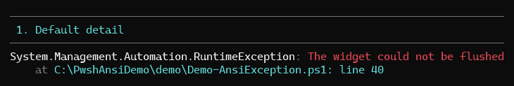

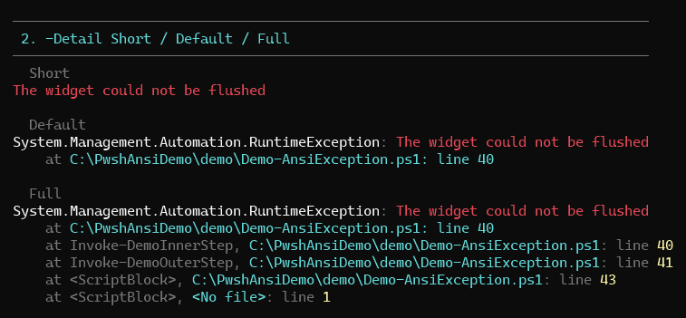
<!-- /demo-media -->

## Frames

`ErrorRecord` input uses `ScriptStackTrace` — the script-level trace, which reads
far better than the CLR one — falling back to `Exception.StackTrace`. Both
formats are parsed, so the path and line number are coloured separately:

```
at Invoke-Step, C:\repo\demo.ps1: line 37      # PowerShell
at Type.Method() in C:\src\File.cs:line 42     # CLR
```

`-MaxFrames` trims the tail and notes what it dropped:

```powershell
Format-AnsiException $record -ShowStackTrace -MaxFrames 2 | Out-AnsiHost
#     at Invoke-DemoInnerStep, C:\repo\demo.ps1: line 37
#     at Invoke-DemoOuterStep, C:\repo\demo.ps1: line 38
#     … 12 more frames
```

<!-- demo-media -->
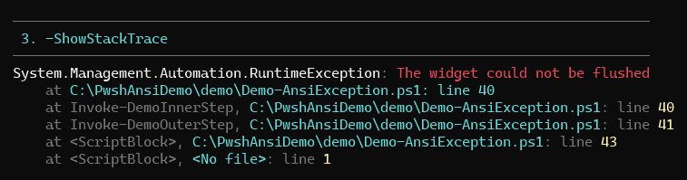

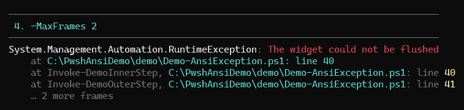
<!-- /demo-media -->

## Inner exceptions

`-Detail Full` walks `InnerException`, indenting one `-Indent` step per level and
marking each with `└─`:

```powershell
Format-AnsiException $nested -Detail Full | Out-AnsiHost
# System.Exception: deploy failed
#     └─ System.InvalidOperationException: database migration aborted
#         └─ System.TimeoutException: connection timed out after 30s
```

<!-- demo-media -->
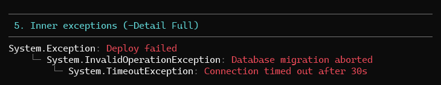
<!-- /demo-media -->

## Width and anchoring

Long messages, positions, and frames fold at the effective width with a hanging
indent, so wrapped text never lines up under the `at`. The first row starts
wherever the cursor already is; later rows resume at the anchor column.

<!-- demo-media -->
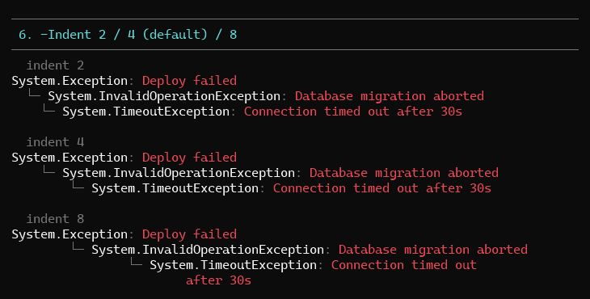

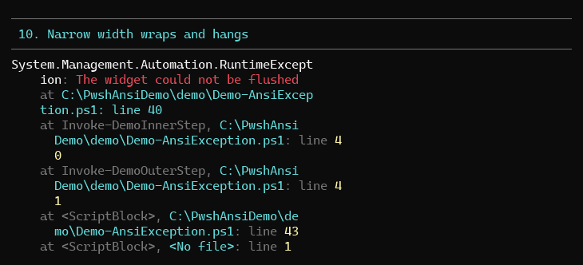

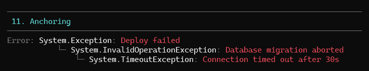

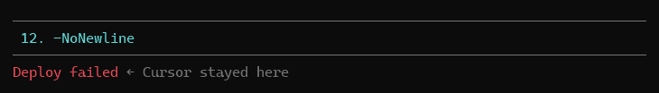
<!-- /demo-media -->

## Usage patterns

**Framed error report**

```powershell
$rows = @((Format-AnsiException $_ -ShowStackTrace -MaxFrames 3 -MaxWidth 60 6>&1) |
    ForEach-Object { [string]$_ })
Format-AnsiPanel $rows -Rendered -Title ':cross: Failed' -Markdown -Border Heavy -BorderColor BrightRed
```

**Report, then rethrow**

```powershell
try { Invoke-Step } catch {
    Format-AnsiException $_ -Detail Default -FrameColor DarkGray | Out-AnsiHost
    throw
}
```

**Quiet summary in a loop**

```powershell
$errors | Format-AnsiException -Detail Short -MessageColor BrightYellow
```

<!-- demo-media -->
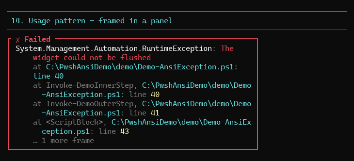

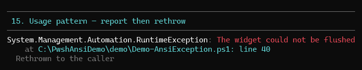

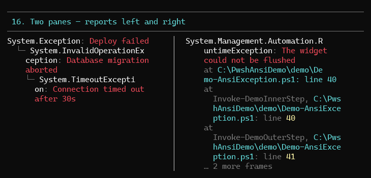
<!-- /demo-media -->

## Demo

```powershell
pwsh -File .\demo\Demo-AnsiException.ps1
```

Numbered sections per feature: default detail, all three detail levels,
`-ShowStackTrace`, `-MaxFrames`, inner exceptions, `-Indent`, colours, bare
strings, `Exception` input, narrow-width wrapping, anchoring, `-NoNewline`,
pipeline input, a framed report, report-then-rethrow, two reports side by side,
`NO_COLOR`.

<!-- demo-media -->
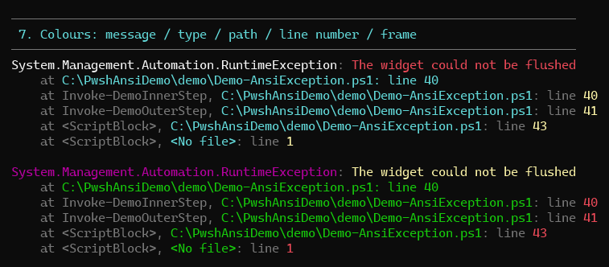

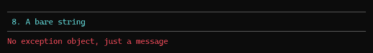

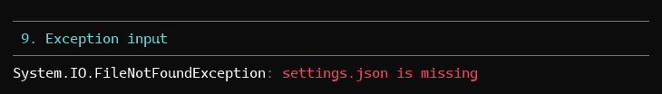

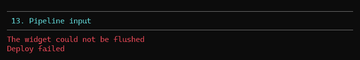

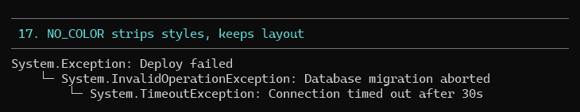
<!-- /demo-media -->

## Tests

`tests/Format-AnsiException.Tests.ps1` — 45 Pester 5 tests covering `ErrorRecord`
and `Exception` input, all three detail levels, position reporting, frame parsing
and indentation, `-MaxFrames` with singular/plural wording, inner-exception
nesting and `-Indent`, all five colour parameters, wrapping with a hanging
indent, anchoring, `-NoNewline`, and the no-colour path.

```powershell
pwsh -File .\Invoke-Test.ps1 -TestName '*AnsiException*'
```
