# Format-AnsiGrid

A borderless grid: aligned columns, no glyphs. Takes explicit rows of cells, or a
flat list flowed into as many columns as the width allows.

`Format-AnsiGrid` replaces the planned Columns and Rows components —
`-Items` covers the flowing case, and a one-column grid is a vertical stack.

## Synopsis

```powershell
Format-AnsiGrid [-Rows] <object[]> | Out-AnsiHost                       # explicit cells
              [-ColumnWidth <int[]>] [-Align <string[]>] [-Padding <int>]
              [-TextColor <string>] [-Wrap] [-Expand]
              [-MaxWidth <int>] [-Markdown] [-Escape] [-NoNewline]

Format-AnsiGrid -Items <object[]> [-ColumnCount <int>] | Out-AnsiHost   # flat list, flowed
              [-ColumnWidth <int[]>] [-Align <string[]>] [-Padding <int>]
              [-TextColor <string>] [-Wrap] [-Expand]
              [-MaxWidth <int>] [-Markdown] [-Escape] [-NoNewline]
```

## Parameters

| Name           | Type                          | Default | Description                                                                              |
| -------------- | ----------------------------- | ------- | ---------------------------------------------------------------------------------------- |
| `-Rows`        | `object[]` (pipeline, pos. 0) | —       | Rows of cells. A scalar row is one cell; a flat list of scalars is one cell per row.       |
| `-Items`       | `object[]` (pipeline)         | —       | Flat list to flow across columns.                                                         |
| `-ColumnCount` | `int`                         | *auto*  | `-Items` only. Without it, as many columns of the widest item as fit.                      |
| `-ColumnWidth` | `int[]`                       | *auto*  | Fixed width per column; `0` (or omitted) sizes that column to content.                    |
| `-Align`       | `string[]`                    | `Left`  | Per-column `Left`/`Center`/`Right`. Fewer values than columns → the last one repeats.      |
| `-Padding`     | `int`                         | `2`     | Spaces between columns.                                                                   |
| `-TextColor`   | `string`                      | none    | Colour for every cell. `-Color` aliases it. Cells that set their own colour win.           |
| `-Wrap`        | `switch`                      | off     | Fold over-long cells onto extra rows instead of ellipsising them.                          |
| `-Expand`      | `switch`                      | off     | Spread the slack across columns instead of sizing to content.                              |
| `-MaxWidth`    | `int`                         | *auto*  | Override the effective width. `-Width` aliases it. Default `BufferWidth - AnchorColumn`.   |
| `-Markdown`    | `switch`                      | off     | Enable [markdown sugar](Markup.md#markdown) in cells.                                     |
| `-Escape`      | `switch`                      | off     | Treat cells as literal text. Wins over `-Markdown`; colours still apply.                   |
| `-NoNewline`   | `switch`                      | off     | Do not emit a trailing newline after the last row.                                         |

Colour names: [Colours](Colours.md). Cell syntax: [Markup and markdown](Markup.md).

## Writing rows — two PowerShell traps

`@()` collects statement output and *unrolls* arrays, so rows need a leading
comma. Without it a row of cells collapses into one cell per row:

```powershell
Format-AnsiGrid @(, @('a', 'b', 'c')) | Out-AnsiHost          # one row, three cells
Format-AnsiGrid @(@('a', 'b', 'c')) | Out-AnsiHost            # WRONG: three rows, one cell each

$rows = @(
    , @('Name', 'Tests')                      # leading comma per row
    , @('Text', '147')
)
```

`,` also binds tighter than `+`, so build cells with parentheses or `-f`:

```powershell
$row = @((('[DarkGray]{0}[/]' -f $key)), (('[BrightWhite]{0}[/]' -f $value)))
```

A flat list of scalars is deliberately one cell per row — that is the vertical
stack that `Format-AnsiRows` would have been:

```powershell
Format-AnsiGrid @('One', 'Two', 'Three') | Out-AnsiHost
# one
# two
# three
```

<!-- demo-media -->
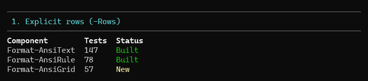

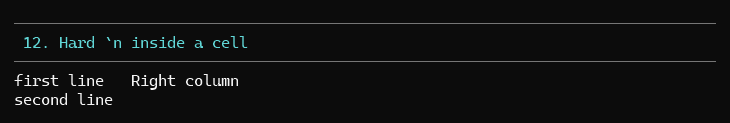

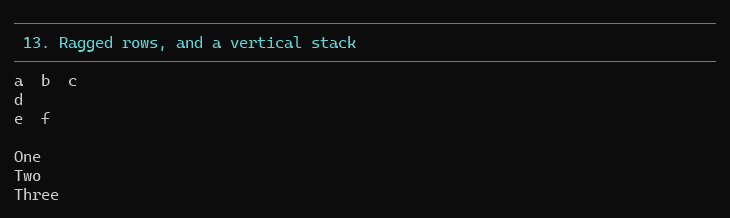
<!-- /demo-media -->

## Flowing a flat list

`-Items` chunks for you. Without `-ColumnCount`, it fits as many columns of the
widest item as the width allows.

```powershell
Format-AnsiGrid -Items (Get-ChildItem .\src -File).Name | Out-AnsiHost
# Ansi.Core.psm1  Format-AnsiText.psm1  Format-AnsiRule.psm1  Format-AnsiPath.psm1
# Format-AnsiJson.psm1  Format-AnsiTree.psm1  Format-AnsiTable.psm1  Format-AnsiGrid.psm1

Format-AnsiGrid -Items $names -ColumnCount 3 | Out-AnsiHost
Format-AnsiGrid -Items $names -MaxWidth 44 | Out-AnsiHost      # fewer columns in a narrow width
```

<!-- demo-media -->
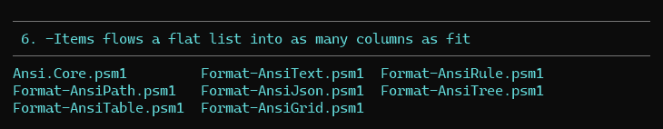

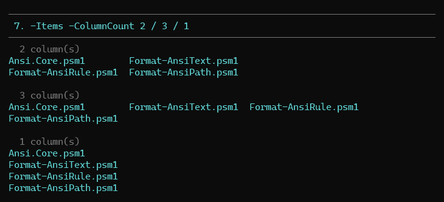

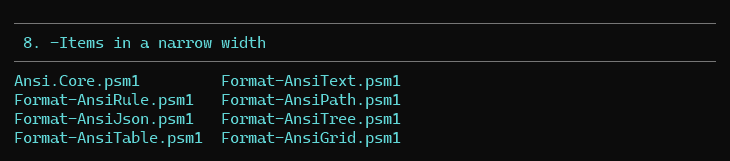
<!-- /demo-media -->

## Nesting another rendering

Any cell may be an `[Ansi.Rendering]`: its rows are used as-is, and the grid row
grows to the tallest cell. That is how two boxes sit side by side without the
capture-and-zip dance:

```powershell
$left = Format-AnsiPanel @('Build  ok') -Title 'CI' -Border Square
$right = Format-AnsiPanel @('Unit  712') -Title 'Counts' -Border Square
Format-AnsiGrid @(, @($left, $right)) -Padding 3 | Out-AnsiHost
```

<!-- demo-media -->
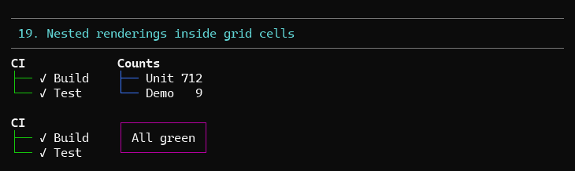
<!-- /demo-media -->

## Sizing

Columns start at their natural width. If the grid would exceed the available
width, the widest column is trimmed one column at a time, then cells ellipsise —
or fold with `-Wrap`. `-Expand` does the opposite and shares the slack out.

```powershell
Format-AnsiGrid $rows -ColumnWidth 20, 0, 10 | Out-AnsiHost    # fixed, content-sized, fixed
Format-AnsiGrid $rows -Expand -MaxWidth 70 | Out-AnsiHost
Format-AnsiGrid $long -MaxWidth 60 -Wrap | Out-AnsiHost
```

A hard `` `n `` inside a cell always adds rows to that cell only; the neighbouring
columns stay on the first line. `-Wrap` is not needed for it.

The right edge carries no trailing padding — a grid has no border — so rows end
after their last visible cell and ragged rows leave no tail.

<!-- demo-media -->
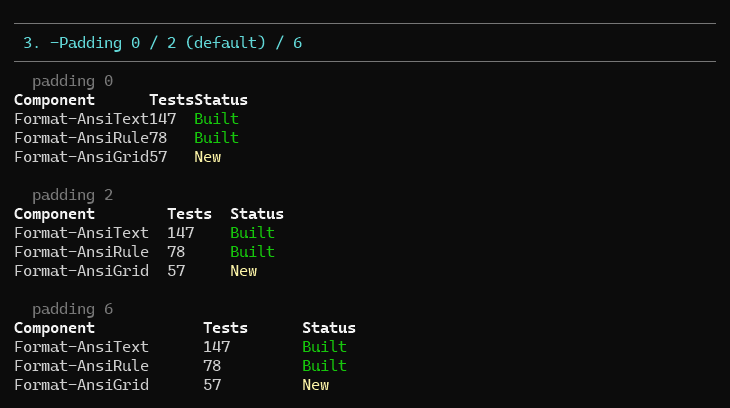

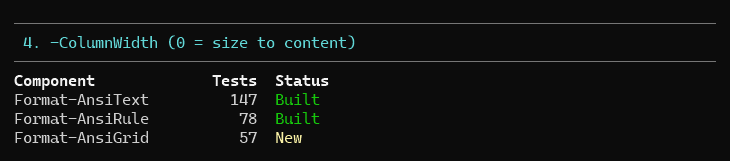

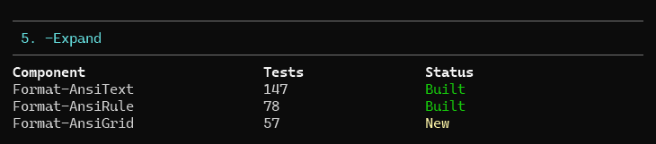

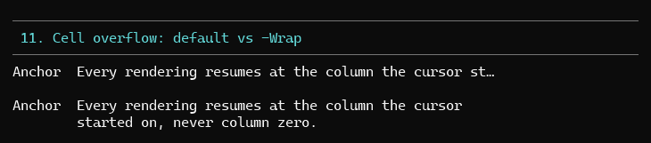
<!-- /demo-media -->

## Anchoring

The first row starts wherever the cursor already is; every later row resumes at
that column.

<!-- demo-media -->
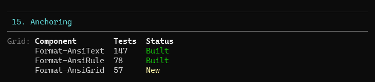


<!-- /demo-media -->

## Usage patterns

**Key/value block**

```powershell
$kv = @()
foreach ($e in $settings.GetEnumerator()) {
    $kv += , @((('[DarkGray]{0}[/]' -f $e.Key)), (('[BrightWhite]{0}[/]' -f $e.Value)))
}
Format-AnsiGrid $kv -Padding 3 | Out-AnsiHost
# Runtime        PowerShell 7.2+
# Dependencies   none
```

**Step/result matrix**

```powershell
Format-AnsiGrid @( | Out-AnsiHost
    , @('restore', '[BrightGreen]:check: ok[/]')
    , @('smoke', '[bold BrightRed]:cross: failed[/]')
) -Markdown -Align Left, Right
```

**`ls`-style listing**

```powershell
Format-AnsiGrid -Items (Get-ChildItem).Name -Color BrightCyan | Out-AnsiHost
```

**Borderless table** — same layout as `Format-AnsiTable -Border None`, but without
headers or property selection; reach for [Format-AnsiTable](Format-AnsiTable.md) when
you want either.

<!-- demo-media -->
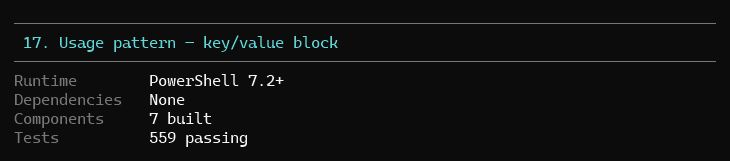

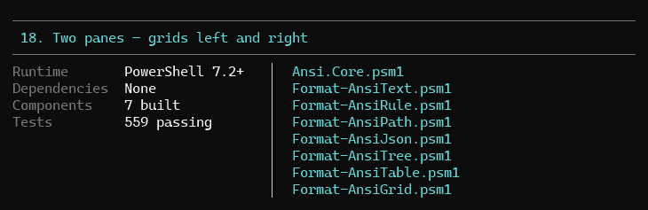
<!-- /demo-media -->

## Demo

```powershell
pwsh -File .\demo\Demo-AnsiGrid.ps1
```

Numbered sections per feature: explicit rows, alignment, padding, `-ColumnWidth`,
`-Expand`, `-Items` flowing, `-ColumnCount`, narrow widths, markup/markdown,
`-Escape`, overflow vs `-Wrap`, hard newlines, ragged rows and vertical stacks,
pipeline input, anchoring, `-NoNewline`, a key/value block, two grids side by
side, `NO_COLOR`.

<!-- demo-media -->
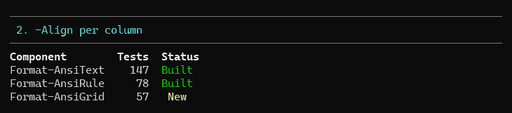

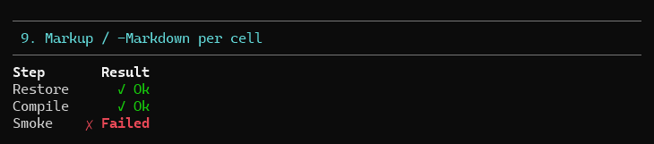

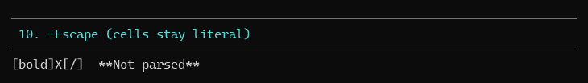

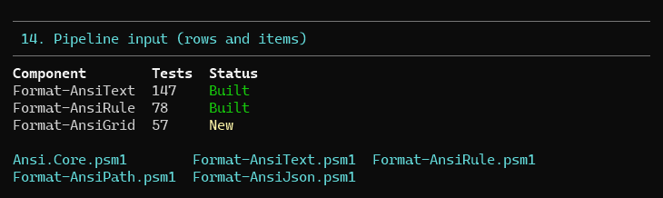

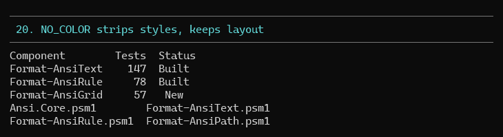
<!-- /demo-media -->

## Tests

`tests/Format-AnsiGrid.Tests.ps1` — 57 Pester 5 tests covering explicit rows,
ragged rows, flat-list stacking, padding, alignment, `-ColumnWidth`, `-Expand`,
`-Items` flow and `-ColumnCount`, parameter-set exclusivity, ellipsis vs `-Wrap`,
hard newlines, markup measurement and colour, anchoring, `-NoNewline`, and the
no-colour path.

```powershell
pwsh -File .\Invoke-Test.ps1 -TestName '*AnsiGrid*'
```
