# Format-AnsiJson

Pretty-prints JSON with per-token colouring. Takes a JSON string or any
PowerShell object, renders one row per token line, and ellipsises rows that do
not fit rather than wrapping them.

## Synopsis

```powershell
Format-AnsiJson [-Data] <object> | Out-AnsiHost
              [-Depth <int>]
              [-IndentSize <int>]
              [-MaxDepth <int>]
              [-KeyColor <string>]
              [-StringColor <string>]
              [-NumberColor <string>]
              [-BooleanColor <string>]
              [-NullColor <string>]
              [-PunctuationColor <string>]
              [-MaxWidth <int>]
              [-NoNewline]
```

## Parameters

| Name                | Type                       | Default         | Description                                                                                             |
| ------------------- | -------------------------- | --------------- | ------------------------------------------------------------------------------------------------------- |
| `-Data`             | `object` (pipeline, pos. 0) | —               | A JSON string, or any object to serialise first. Several pipeline items render as one array.             |
| `-Depth`            | `int` (1–100)              | `10`            | Serialisation depth for object input. Deeper nodes stringify, as with `ConvertTo-Json`. Parsing is never limited by it. |
| `-IndentSize`       | `int` (0–16)               | `2`             | Spaces per nesting level. `0` renders every row flush left.                                             |
| `-MaxDepth`         | `int`                      | `0` (unlimited) | Render depth. Nodes at or below the limit collapse to `{…}` / `[…]`.                                     |
| `-KeyColor`         | `string`                   | `BrightBlue`    | Property names.                                                                                          |
| `-StringColor`      | `string`                   | `BrightGreen`   | String values.                                                                                           |
| `-NumberColor`      | `string`                   | `BrightCyan`    | Numeric values.                                                                                          |
| `-BooleanColor`     | `string`                   | `BrightMagenta` | `true` / `false`.                                                                                        |
| `-NullColor`        | `string`                   | `BrightBlack`   | `null`.                                                                                                  |
| `-PunctuationColor` | `string`                   | none            | Braces, brackets, commas, and `: ` separators. Unstyled by default.                                      |
| `-MaxWidth`         | `int`                      | *auto*          | Override the effective width. Default is `BufferWidth - AnchorColumn`.                                    |
| `-NoNewline`        | `switch`                   | off             | Do not emit a trailing newline after the last row.                                                        |

Colour names: [Colours](Colours.md). There is no `-Markdown` or `-Escape` — JSON
content is never parsed as markup.

## Input forms

```powershell
Format-AnsiJson '{"name":"ansi","count":3}' | Out-AnsiHost                  # JSON string, parsed
Format-AnsiJson ([PSCustomObject]@{ name = 'PwshAnsi' }) | Out-AnsiHost          # object, serialised
Format-AnsiJson ([ordered]@{ z = 1; a = 2 }) | Out-AnsiHost                 # key order preserved
Format-AnsiJson @{ name = 'PwshAnsi' } | Out-AnsiHost                            # hashtable (unordered)
Get-Process -Id $PID | Select-Object Id, Name | Format-AnsiJson
1, 2, 3 | Format-AnsiJson                                    # → one JSON array
```

A string that does not parse as JSON is rendered as a JSON string value, so
`Format-AnsiJson 'hello'` prints `"hello"`. Scalars pass straight through: `42`,
`true`, `null`. Empty containers render inline as `{}` and `[]`, at the root and
nested.

Use `[ordered]@{}` or a `PSCustomObject` when key order matters — a plain
hashtable has none.

<!-- demo-media -->
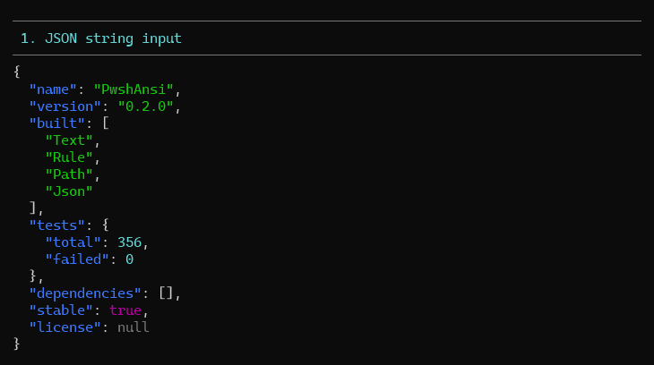

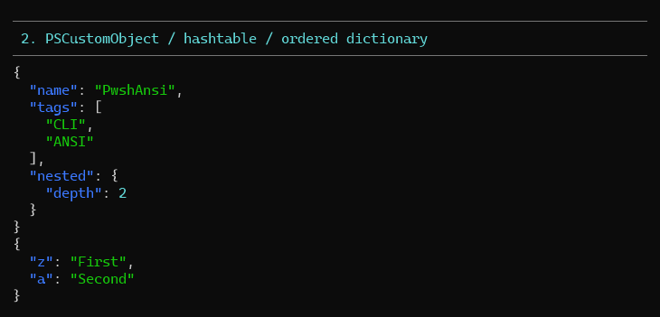

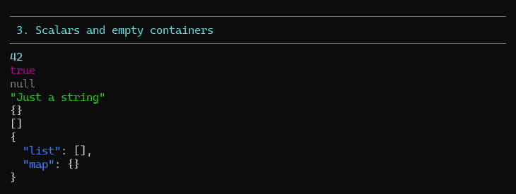

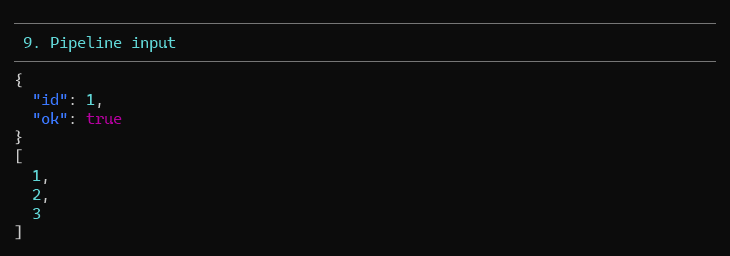

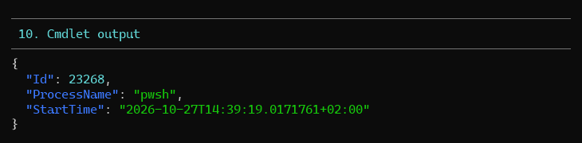
<!-- /demo-media -->

## Structure and indentation

```powershell
Format-AnsiJson '{"a":{"b":1}}' | Out-AnsiHost
# {
#   "a": {
#     "b": 1
#   }
# }

Format-AnsiJson '{"a":{"b":1}}' -IndentSize 4 | Out-AnsiHost
# {
#     "a": {
#         "b": 1
#     }
# }
```

<!-- demo-media -->
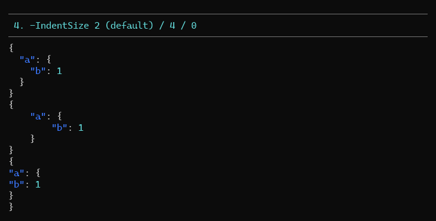
<!-- /demo-media -->

## Depth limits

`-MaxDepth` is a *rendering* limit: nodes past it collapse to a single token, so
a large document stays skimmable. Empty containers are never collapsed.

```powershell
$deep = '{"a":{"b":{"c":1}},"list":[1,2,3]}'
Format-AnsiJson $deep -MaxDepth 1 | Out-AnsiHost
# {
#   "a": {…},
#   "list": […]
# }
```

`-Depth` is a *serialisation* limit and only applies to object input, exactly as
in `ConvertTo-Json`: nodes deeper than it become strings (and `ConvertTo-Json`
emits its usual warning). JSON string input is always parsed in full, whatever
`-Depth` says.

<!-- demo-media -->
![5. -MaxDepth collapses deeper nodes to {…} / \[…\]](media/AnsiJson/5.png)

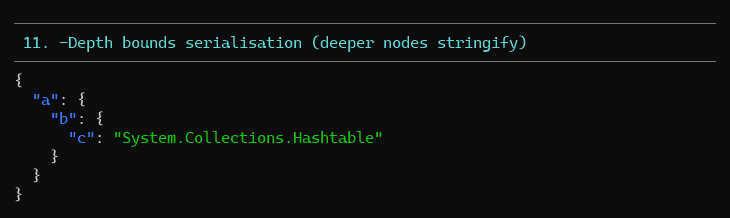
<!-- /demo-media -->

## Width

Rows wider than the effective width are truncated with `…`. JSON is never
wrapped: a broken row reads worse than a shortened one.

```powershell
Format-AnsiJson $payload -MaxWidth 50 | Out-AnsiHost
# {
#   "note": "xxxxxxxxxxxxxxxxxxxxxxxxxxxxxxxxxxxxxxxxxxxxx…
#   "short": 1
# }
```

<!-- demo-media -->
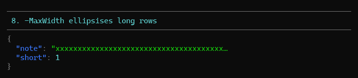
<!-- /demo-media -->

## Anchoring

The first row starts wherever the cursor already is; every later row resumes at
that column, so a document nests under its prefix.

```powershell
Write-Host 'Config: ' -NoNewline
Format-AnsiJson '{"retries":3}' | Out-AnsiHost
# config: {
#           "retries": 3
#         }
```

<!-- demo-media -->
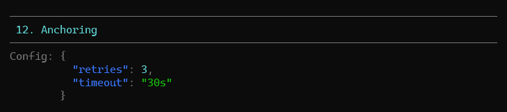

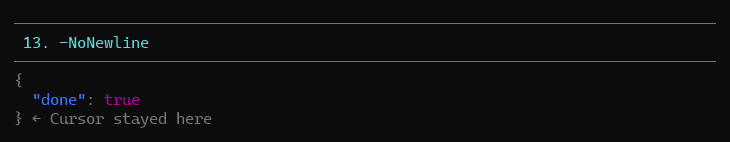
<!-- /demo-media -->

## Usage patterns

**Inspect a settings file**

```powershell
Get-Content .\settings.json -Raw | Format-AnsiJson -PunctuationColor DarkGray
```

**Skim a large API response**

```powershell
$response | Format-AnsiJson -MaxDepth 2 -MaxWidth 100
```

**De-emphasise everything but the values**

```powershell
Format-AnsiJson $data -KeyColor DarkGray -PunctuationColor DarkGray -StringColor BrightWhite | Out-AnsiHost
```

**Log a request body next to a label**

```powershell
Write-Host 'Body: ' -NoNewline -ForegroundColor DarkGray
Format-AnsiJson $body -MaxDepth 3 | Out-AnsiHost
```

<!-- demo-media -->
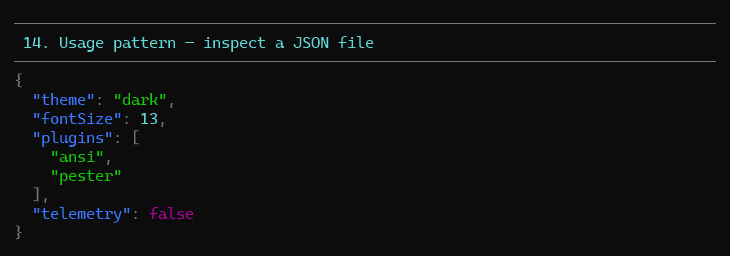

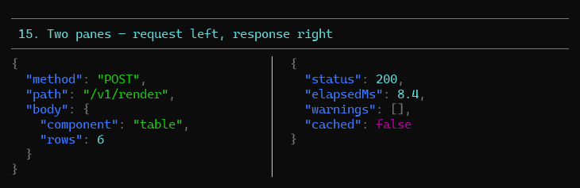
<!-- /demo-media -->

## Demo

```powershell
pwsh -File .\demo\Demo-AnsiJson.ps1
```

Numbered sections per feature: JSON string input, object/hashtable/ordered
input, scalars and empty containers, `-IndentSize`, `-MaxDepth`, value colours,
`-PunctuationColor`, `-MaxWidth` truncation, pipeline input, cmdlet output,
`-Depth`, anchoring, `-NoNewline`, reading a file, `NO_COLOR`.

<!-- demo-media -->
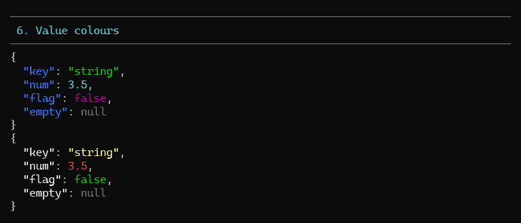

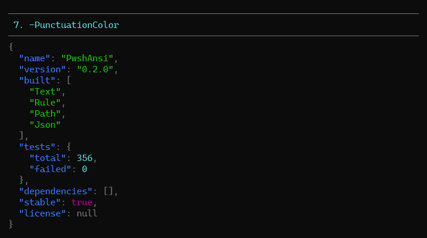

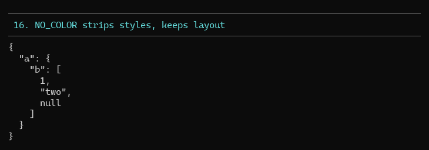
<!-- /demo-media -->

## Tests

`tests/Format-AnsiJson.Tests.ps1` — 67 Pester 5 tests covering JSON string and
object input, scalars, empty containers at every position, escaping,
`-IndentSize`, `-MaxDepth`, `-Depth`, all six colour parameters, row
truncation, anchoring, `-NoNewline`, and the no-colour path.

```powershell
pwsh -File .\Invoke-Test.ps1 -TestName '*AnsiJson*'
```
