# Format-AnsiPanel

Frames a block of text: border, optional title set into the top rule, inner
padding. Content is `[string[]]`, so with `-Rendered` it also frames rows captured
from another `Format-Ansi*` — the one place the library composes.

## Synopsis

```powershell
Format-AnsiPanel [-Data] <string[]> | Out-AnsiHost
               [-Title <string>] [-TitleAlignment <Left|Center|Right>]
               [-Border <None|Ascii|Square|Rounded|Heavy|Double>]
               [-BorderColor <string>] [-TextColor <string>] [-TitleColor <string>]
               [-Justify <Left|Center|Right>]
               [-Padding <int>]
               [-Width <int>]              # -MaxWidth is an alias
               [-Height <int>]
               [-Expand]
               [-Rendered]
               [-Markdown] [-Escape] [-NoNewline]
```

## Parameters

| Name              | Type                            | Default   | Description                                                                                     |
| ----------------- | ------------------------------- | --------- | ----------------------------------------------------------------------------------------------- |
| `-Data`           | `string[]` (pipeline, pos. 0)   | —         | Lines to frame. A hard `` `n `` inside a line splits it. Long lines wrap to the inner width.      |
| `-Title`          | `string`                        | none      | Caption set into the top rule as `╭─ Title ─╮`. Widens the panel if longer than the content.      |
| `-TitleAlignment` | `Left`\|`Center`\|`Right`       | `Left`    | Where the title sits along the top rule.                                                         |
| `-Border`         | see below                       | `Rounded` | Border style. `None` keeps the layout but draws nothing.                                         |
| `-BorderColor`    | `string`                        | none      | Colour of the frame. Also the title's default colour.                                            |
| `-TextColor`      | `string`                        | none      | Colour of the content. Lines that set their own colour via markup win.                            |
| `-TitleColor`     | `string`                        | *border*  | Colour of the title.                                                                             |
| `-Justify`        | `Left`\|`Center`\|`Right`       | `Left`    | Horizontal alignment of content inside the panel.                                                |
| `-Padding`        | `int`                           | `1`       | Spaces between the border and the content on each side.                                          |
| `-Width`          | `int`                           | *auto*    | Total panel width. Default `BufferWidth - AnchorColumn`. `-MaxWidth` aliases it.                  |
| `-Height`         | `int`                           | *auto*    | Total row count including both rules: pads with blank rows, or drops the overflow.                |
| `-Expand`         | `switch`                        | off       | Fill the available width instead of sizing to content.                                           |
| `-Rendered`       | `switch`                        | off       | Content is already rendered: pass it through, measure visible width, truncate instead of wrap.    |
| `-Markdown`       | `switch`                        | off       | Enable [markdown sugar](Markup.md#markdown) in content and title.                                 |
| `-Escape`         | `switch`                        | off       | Treat content as literal text. Wins over `-Markdown`; colours still apply.                        |
| `-NoNewline`      | `switch`                        | off       | Do not emit a trailing newline after the bottom rule.                                            |

Colour names: [Colours](Colours.md). Content syntax: [Markup and markdown](Markup.md).

## Borders

| `-Border` | Corners      |
| --------- | ------------ |
| `Rounded` | `╭ ╮ ╰ ╯` (default) |
| `Square`  | `┌ ┐ └ ┘`    |
| `Heavy`   | `┏ ┓ ┗ ┛`    |
| `Double`  | `╔ ╗ ╚ ╝`    |
| `Ascii`   | `+ + + +`    |
| `None`    | no glyphs, layout unchanged |

```powershell
Format-AnsiPanel 'Hello' | Out-AnsiHost
# ╭───────╮
# │ hello │
# ╰───────╯

Format-AnsiPanel 'Body text here' -Title 'Build' | Out-AnsiHost
# ╭ Build ─────────╮
# │ body text here │
# ╰────────────────╯
```

<!-- demo-media -->
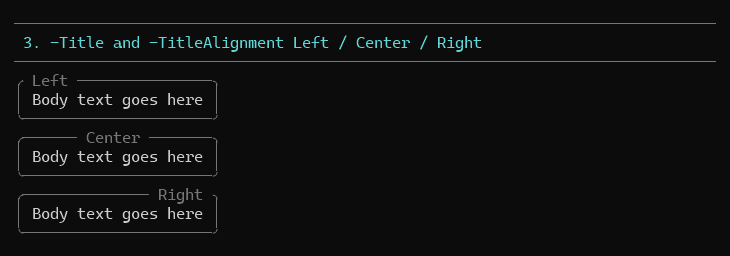

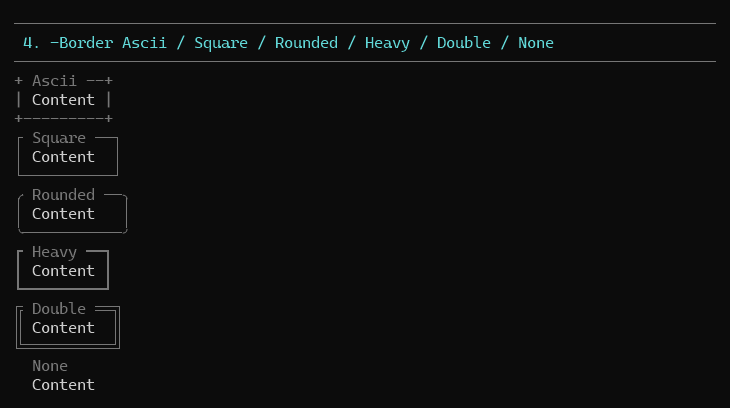
<!-- /demo-media -->

## Sizing

The panel sizes to its widest line, widening if the title needs more room, and
never exceeds the available width — content wraps to the inner width. `-Expand`
fills the width instead; `-Height` fixes the row count.

```powershell
Format-AnsiPanel $paragraph -Width 46 | Out-AnsiHost          # wraps inside the frame
Format-AnsiPanel 'x' -Expand | Out-AnsiHost                    # fills the buffer
Format-AnsiPanel @('a', 'b') -Height 6 | Out-AnsiHost          # pads to six rows
Format-AnsiPanel @('a', 'b', 'c', 'd') -Height 3 | Out-AnsiHost # keeps the first row only
```

<!-- demo-media -->
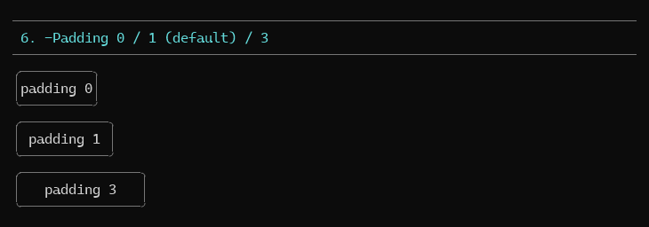

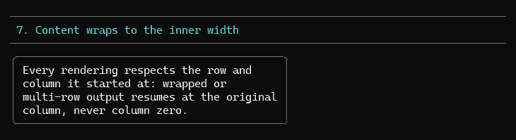

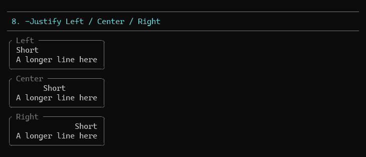

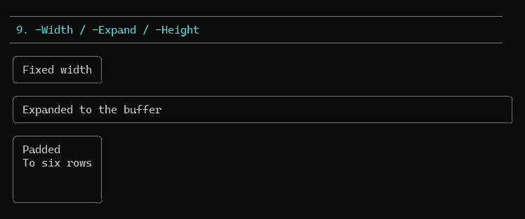
<!-- /demo-media -->

## Nesting another rendering

`-Data` accepts `[Ansi.Rendering]` objects as well as strings, so a panel can frame
any other component row for row — and mix the two in order:

```powershell
$table = Format-AnsiTable $rows -Border None -MaxWidth 24
Format-AnsiPanel $table -Title 'Stats' | Out-AnsiHost
Format-AnsiPanel @('Before', $table, 'After') -Title 'Mixed' | Out-AnsiHost
```

Nested rows are measured on their runs, so no visible-width guessing is involved.
`-Content` is an alias of `-Data` when the content is a single rendering.

<!-- demo-media -->
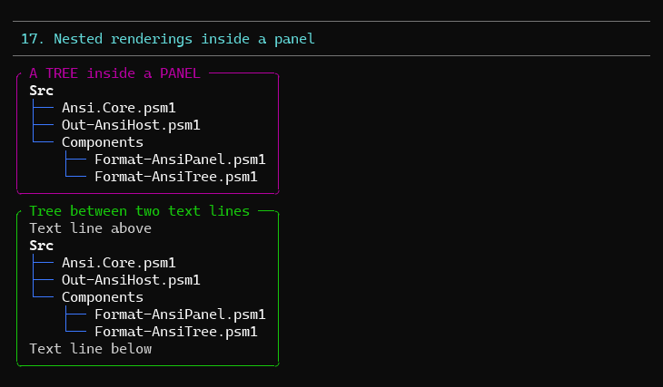
<!-- /demo-media -->

## Framing pre-rendered strings with -Rendered

Captured rows carry ANSI, which a naive width measure would count as characters.
`-Rendered` measures *visible* width (CSI and OSC 8 stripped), skips markup
parsing, and truncates over-long rows with `…` rather than re-wrapping them —
re-wrapping pre-rendered output would break its own alignment.

```powershell
function Get-Rows {
    param([scriptblock]$Render)
    $rows = @((& $Render 6>&1) | ForEach-Object { [string]$_ })
    return , $rows
}

$tree = Get-Rows { Format-AnsiTree $data -MaxWidth 30 -Color DarkGray }
Format-AnsiPanel $tree -Rendered -Title 'Tree' -BorderColor BrightBlue | Out-AnsiHost
# ╭ tree ───────────────────╮
# │ src                     │
# │ ├── Ansi.Core.psm1       │
# │ └── Format-AnsiGrid.psm1  │
# ╰─────────────────────────╯
```

<!-- demo-media -->
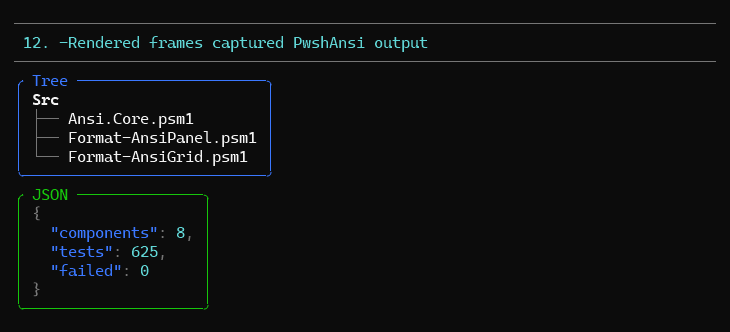
<!-- /demo-media -->

## Anchoring

The top rule starts wherever the cursor already is; every later row resumes at
that column, so the whole box hangs under its prefix.

<!-- demo-media -->
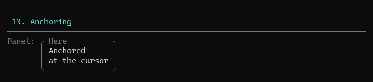

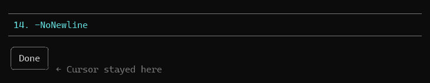
<!-- /demo-media -->

## Usage patterns

**Error callout**

```powershell
Format-AnsiPanel @( | Out-AnsiHost
    '[bold]Cannot bind argument to parameter ''Runs''[/]'
    ''
    'at Split-AnsiRuns, Ansi.Core.psm1: line 261'
) -Title '[bold]:cross: error[/]' -Markdown -Border Heavy -BorderColor BrightRed
```

**Two panels side by side** — capture each pane and zip the rows (see
[Format-AnsiTree](Format-AnsiTree.md#usage-patterns)); `-Expand -Width <pane>` keeps
both boxes the same width.

**Help block**

```powershell
Format-AnsiPanel $usageLines -Title 'Usage' -Border Square -BorderColor DarkGray -Padding 2 | Out-AnsiHost
```

<!-- demo-media -->
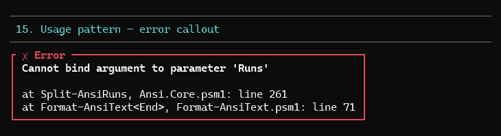

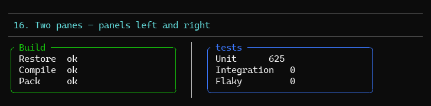
<!-- /demo-media -->

## Demo

```powershell
pwsh -File .\demo\Demo-AnsiPanel.ps1
```

Numbered sections per feature: framed text, multiple lines, title alignment,
every border, colours, padding, wrapping, `-Justify`, `-Width`/`-Expand`/`-Height`,
markup/markdown, `-Escape`, `-Rendered` framing tree and json output, anchoring,
`-NoNewline`, an error callout, two panels side by side, `NO_COLOR`.

<!-- demo-media -->
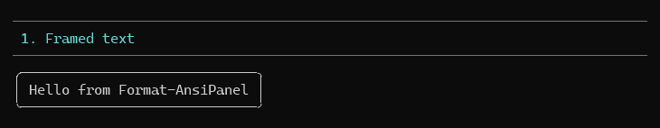

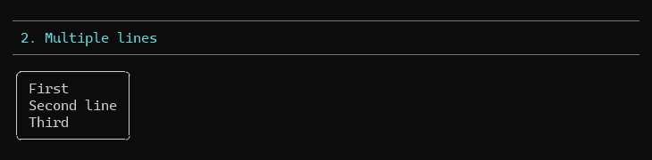

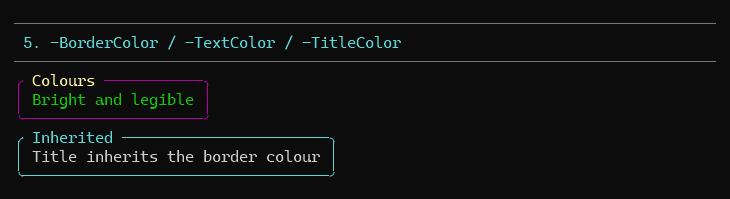

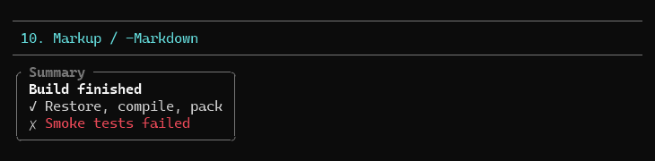

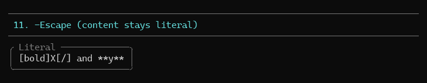

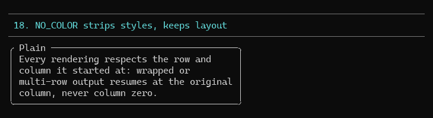
<!-- /demo-media -->

## Tests

`tests/Format-AnsiPanel.Tests.ps1` — 66 Pester 5 tests covering frame layout, title
placement and widening, every border, padding, `-Justify`, wrapping, `-Expand`,
`-Height` padding and truncation, all three colour parameters, markup
measurement, `-Rendered` visible-width measurement and pass-through (including
framing captured grid output), anchoring, `-NoNewline`, and the no-colour path.

```powershell
pwsh -File .\Invoke-Test.ps1 -TestName '*AnsiPanel*'
```
