# Format-AnsiPath

Renders filesystem paths one per row, colouring root, separators, stem segments,
and leaf independently. Paths too wide for the row lose their middle segments to
a single `…` rather than wrapping.

## Synopsis

```powershell
Format-AnsiPath [-Path] <string[]> | Out-AnsiHost
              [-PathColor <string>]        # -Color is an alias
              [-RootColor <string>]
              [-SeparatorColor <string>]
              [-StemColor <string>]
              [-LeafColor <string>]
              [-Alignment <Left|Center|Right>]
              [-MaxWidth <int>]
              [-NoNewline]
```

## Parameters

| Name              | Type                          | Default | Description                                                                                                     |
| ----------------- | ----------------------------- | ------- | --------------------------------------------------------------------------------------------------------------- |
| `-Path`           | `string[]` (pipeline, pos. 0) | —       | Paths to render, one row each. Binds `FullName`/`PSPath`, so `Get-ChildItem` pipes straight in. Never validated. |
| `-PathColor`      | `string`                      | none    | Base colour for every part. `-Color` aliases this parameter.                                                     |
| `-RootColor`      | `string`                      | *base*  | Colour of the root (`C:\`, `/`, `\\server\share\`, `~/`).                                                        |
| `-SeparatorColor` | `string`                      | *base*  | Colour of the separators only.                                                                                   |
| `-StemColor`      | `string`                      | *base*  | Colour of the intermediate segments, and of the `…` that replaces dropped ones.                                  |
| `-LeafColor`      | `string`                      | *base*  | Colour of the final segment.                                                                                     |
| `-Alignment`      | `Left`\|`Center`\|`Right`     | `Left`  | Horizontal alignment within the effective width.                                                                 |
| `-MaxWidth`       | `int`                         | *auto*  | Override the effective width. Default is `BufferWidth - AnchorColumn`.                                            |
| `-NoNewline`      | `switch`                      | off     | Do not emit a trailing newline after the last row.                                                                |

Colour names: [Colours](Colours.md). There is no `-Markdown` or `-Escape` — a
path is never parsed as markup, so brackets in filenames are safe.

## Path shapes

Roots are recognised, not rewritten: nothing is resolved, expanded, or checked
for existence.

| Input                              | Root              |
| ---------------------------------- | ----------------- |
| `C:\Users\repo\file.txt`           | `C:\`             |
| `/usr/local/share/doc/readme.md`   | `/`               |
| `\\server\share\team\notes.docx`   | `\\server\share\` |
| `~/projects/ansi/src/core.psm1`     | `~/`              |
| `src\Format-AnsiPath.psm1`           | none (relative)   |
| `..\..\build\output.zip`           | none (relative)   |

A trailing separator marks the last segment as a container, so `C:\Users\repo\`
has no leaf and `-LeafColor` does not apply.

The separator that appears first is the one rendered throughout, so mixed input
is normalised and repeated separators collapse:

```powershell
Format-AnsiPath 'C:/Users\repo/file.txt' | Out-AnsiHost    # → C:/Users/repo/file.txt
Format-AnsiPath 'C:\Users\\repo\file.txt' | Out-AnsiHost   # → C:\Users\repo\file.txt
```

<!-- demo-media -->
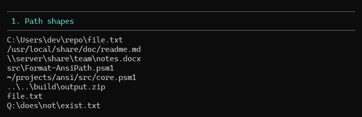

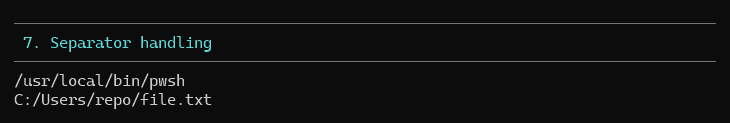
<!-- /demo-media -->

## Truncation

A path wider than the row keeps its root and leaf and gives up stem segments
from the left, standing them in with one `…`. Segments are dropped one at a time
until the row fits. If root plus leaf still will not fit, the leaf itself is
ellipsised.

```powershell
$deep = 'C:\Users\dev\repos\PwshAnsi\src\deeply\nested\file.txt'
Format-AnsiPath $deep -MaxWidth 46 | Out-AnsiHost   # C:\…\PwshAnsi\src\deeply\nested\file.txt
Format-AnsiPath $deep -MaxWidth 34 | Out-AnsiHost   # C:\…\src\deeply\nested\file.txt
Format-AnsiPath $deep -MaxWidth 26 | Out-AnsiHost   # C:\…\nested\file.txt
Format-AnsiPath $deep -MaxWidth 18 | Out-AnsiHost   # C:\…\file.txt
Format-AnsiPath $deep -MaxWidth 12 | Out-AnsiHost   # C:\…\file.t…
```

<!-- demo-media -->
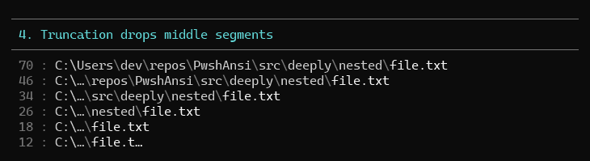

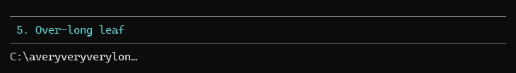
<!-- /demo-media -->

## Anchoring

The first row starts wherever the cursor already is; every later row resumes at
that column, so a list of paths hangs under its prefix.

```powershell
Write-Host 'Loaded: ' -NoNewline
Format-AnsiPath 'src\core.psm1', 'src\text.psm1', 'src\rule.psm1' | Out-AnsiHost
# Loaded: src\core.psm1
#         src\text.psm1
#         src\rule.psm1
```

<!-- demo-media -->
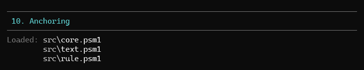

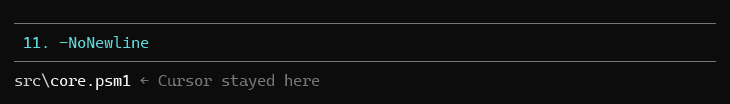
<!-- /demo-media -->

## Input forms

```powershell
Format-AnsiPath 'src\a.ps1', 'src\b.ps1' | Out-AnsiHost                    # array, one row each
'src\a.ps1', 'src\b.ps1' | Format-AnsiPath                  # pipeline
Get-ChildItem .\src -File | Format-AnsiPath                 # binds FullName
[PSCustomObject]@{ FullName = 'C:\a\b.txt' } | Format-AnsiPath
```

An empty string renders one blank row; `$null` and an empty collection render
nothing.

<!-- demo-media -->
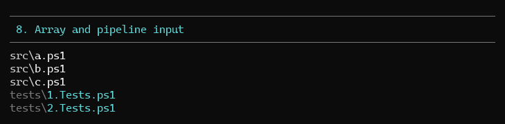

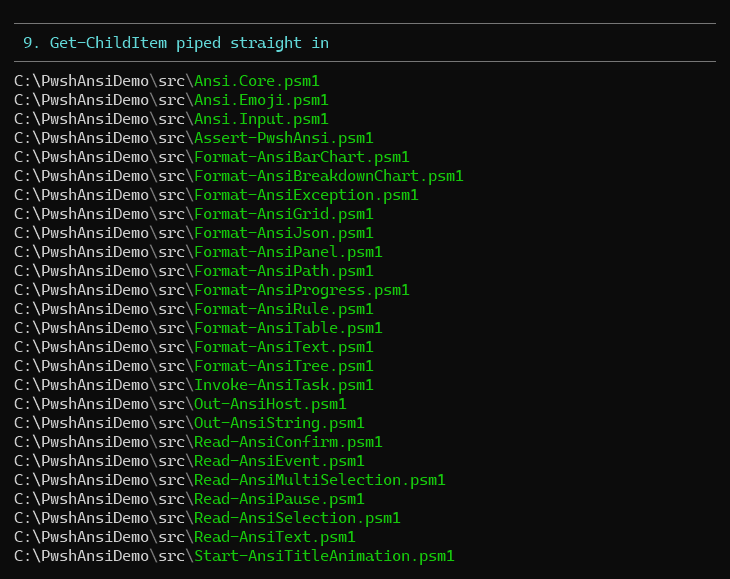
<!-- /demo-media -->

## Usage patterns

**Annotated file list**

```powershell
foreach ($f in Get-ChildItem .\src -File) {
    Write-Host ('{0,8:n0} B  ' -f $f.Length) -NoNewline -ForegroundColor DarkGray
    Format-AnsiPath $f.FullName -MaxWidth 50 -SeparatorColor DarkGray -LeafColor BrightWhite | Out-AnsiHost
}
```

**De-emphasised path, highlighted filename**

```powershell
Format-AnsiPath $file -Color DarkGray -LeafColor BrightWhite | Out-AnsiHost
```

**Error location**

```powershell
Write-Host 'Error in ' -NoNewline -ForegroundColor BrightRed
Format-AnsiPath $script -RootColor DarkGray -StemColor DarkGray -LeafColor BrightRed | Out-AnsiHost
```

<!-- demo-media -->
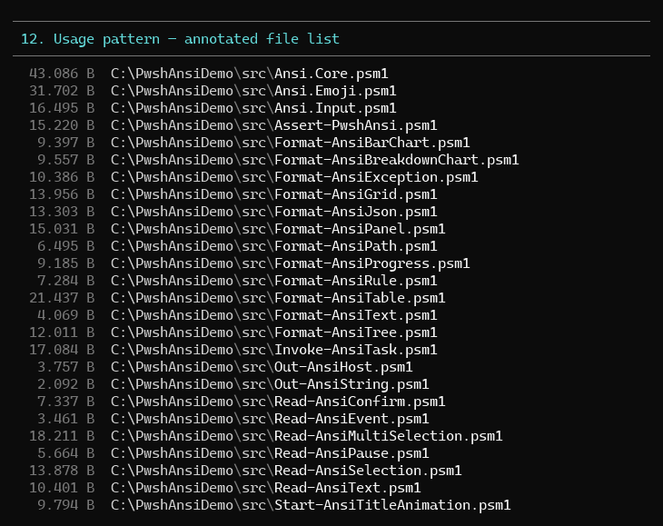

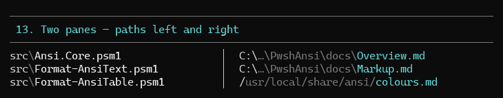
<!-- /demo-media -->

## Demo

```powershell
pwsh -File .\demo\Demo-AnsiPath.ps1
```

Numbered sections per feature: path shapes, part colours, `-Color` base,
truncation ladder, over-long leaf, alignment, separator handling, array/pipeline
input, `Get-ChildItem` binding, anchoring, `-NoNewline`, annotated file list,
`NO_COLOR`.

<!-- demo-media -->
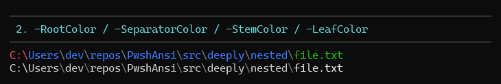

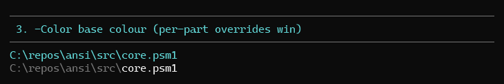

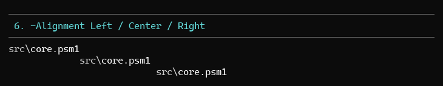

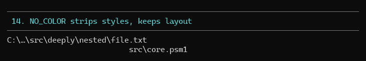
<!-- /demo-media -->

## Tests

`tests/Format-AnsiPath.Tests.ps1` — 64 Pester 5 tests covering every path shape,
separator normalisation, all four part colours and the base colour, the
truncation ladder, leaf ellipsis, alignment, array/pipeline/`FullName` input,
anchoring, `-NoNewline`, and the no-colour path.

```powershell
pwsh -File .\Invoke-Test.ps1 -TestName '*AnsiPath*'
```
