# Format-AnsiRule

Draws a single horizontal rule with an optional title. Anchored to the caller's
cursor column by default, so a rule inside indented output lines up with it.

## Synopsis

```powershell
Format-AnsiRule [[-Title] <string>] | Out-AnsiHost
              [-Alignment <Left|Center|Right>]
              [-TitleColor <string>]        # -Color is an alias
              [-LineColor <string>]
              [-Border <Line|Double|Heavy|Ascii|Dashed|Dotted>]
              [-Char <string>]
              [-TitlePadding <int>]
              [-Width <int>]
              [-Expand]
              [-Spacing <int>]
              [-Markdown]
              [-Escape]
              [-NoNewline]
```

## Parameters

| Name            | Type                       | Default  | Description                                                                                                        |
| --------------- | -------------------------- | -------- | ------------------------------------------------------------------------------------------------------------------ |
| `-Title`        | `string` (pipeline, pos. 0) | none     | Optional heading. Empty or `$null` renders a plain line. One rule per pipeline item. A hard `` `n `` becomes a space. |
| `-Alignment`    | `Left`\|`Center`\|`Right`  | `Left`   | Where the title sits on the row.                                                                                   |
| `-TitleColor`   | `string`                   | none     | Title colour. `-Color` aliases this parameter. Runs that set their own colour via markup win.                      |
| `-LineColor`    | `string`                   | none     | Colour of the line segments only.                                                                                  |
| `-Border`       | see below                  | `Line`   | Which character the line is drawn with.                                                                            |
| `-Char`         | `string`                   | none     | Literal override for the line character. Tiles multi-character strings. Wins over `-Border`.                        |
| `-TitlePadding` | `int`                      | `1`      | Spaces between the title and the line, on every side that carries a line.                                          |
| `-Width`        | `int`                      | *auto*   | Override the rule width. Default is `BufferWidth - AnchorColumn` (or `BufferWidth` with `-Expand`).                 |
| `-Expand`       | `switch`                   | off      | Draw from column 0 across the whole buffer, ignoring the anchor column.                                             |
| `-Spacing`      | `int`                      | `0`      | Blank rows emitted before and after the rule.                                                                       |
| `-Markdown`     | `switch`                   | off      | Enable [markdown sugar](Markup.md#markdown) in the title.                                                           |
| `-Escape`       | `switch`                   | off      | Treat the title as literal text. Wins over `-Markdown`; `-TitleColor` still applies.                                |
| `-NoNewline`    | `switch`                   | off      | Do not emit a trailing newline after the last row.                                                                  |

## Borders

| `-Border` | Character | |
| --------- | --------- | - |
| `Line`    | `U+2500`  | ─ |
| `Double`  | `U+2550`  | ═ |
| `Heavy`   | `U+2501`  | ━ |
| `Ascii`   | `-`       | - |
| `Dashed`  | `U+2504`  | ┄ |
| `Dotted`  | `U+2508`  | ┈ |

`-Char` bypasses the set entirely and tiles whatever you give it:

```powershell
Format-AnsiRule -Char '=' -Width 20 | Out-AnsiHost      # ====================
Format-AnsiRule -Char '<>' -Width 7 | Out-AnsiHost      # <><><><
```

<!-- demo-media -->
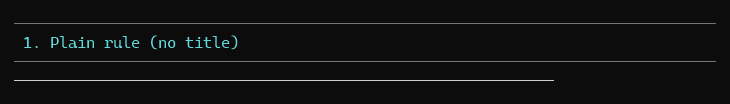

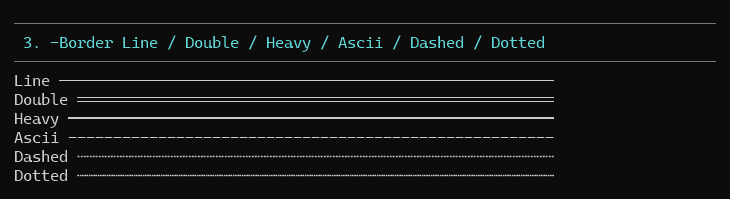

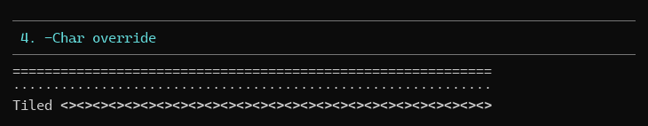
<!-- /demo-media -->

## Title layout

The row always fills the width exactly. Left and right alignment keep one line
segment; centring keeps one on each side.

```powershell
Format-AnsiRule 'Setup' -Width 20 | Out-AnsiHost                     # Setup ──────────────
Format-AnsiRule 'Setup' -Width 20 -Alignment Center | Out-AnsiHost   # ────── Setup ───────
Format-AnsiRule 'Setup' -Width 20 -Alignment Right | Out-AnsiHost    # ────────────── Setup
Format-AnsiRule 'Setup' -Width 20 -TitlePadding 0 | Out-AnsiHost     # Setup───────────────
```

A title too wide for the row is ellipsised with `…` (the same overflow engine
`Format-AnsiText -Overflow Ellipsis` uses). When the width leaves no room for a
readable title at all, the title is dropped and a plain line is drawn.

```powershell
Format-AnsiRule 'A very long title indeed' -Width 12 | Out-AnsiHost  # A very lo… ─
Format-AnsiRule 'Title' -Width 3 | Out-AnsiHost                      # ───
```

<!-- demo-media -->
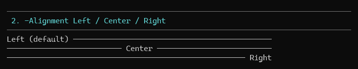

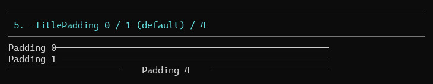

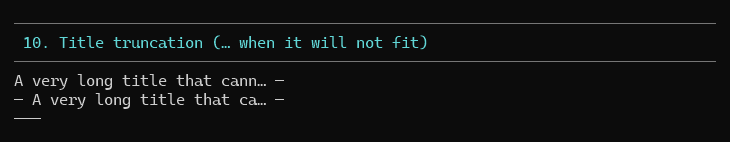
<!-- /demo-media -->

## Styling

Colour names: [Colours](Colours.md). Tags, markdown sugar, emoji, escaping:
[Markup and markdown](Markup.md).

```powershell
Format-AnsiRule 'Deploy' -Color BrightWhite -LineColor DarkGray | Out-AnsiHost
Format-AnsiRule '**Done** :check:' -Markdown -Alignment Center | Out-AnsiHost
Format-AnsiRule '[BrightGreen]Passed[/]' -LineColor BrightBlack | Out-AnsiHost
```

<!-- demo-media -->
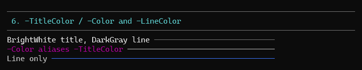

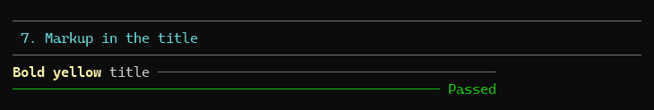

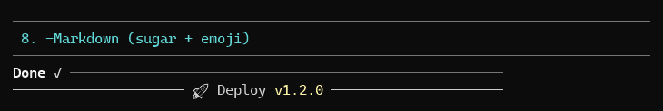

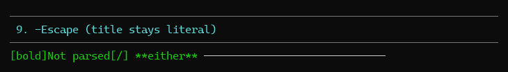
<!-- /demo-media -->

## Anchoring, width, and spacing

By default the rule starts at the cursor column and runs to the buffer edge,
matching every other PwshAnsi rendering. `-Expand` opts out and spans the
full buffer from column 0 — use it for section separators that should ignore the
surrounding indentation.

```powershell
Write-Host '  ' -NoNewline
Format-AnsiRule 'Section' | Out-AnsiHost            # indented rule, 2 columns narrower
Format-AnsiRule 'Section' -Expand | Out-AnsiHost    # full-width rule
Format-AnsiRule 'Section' -Spacing 1 | Out-AnsiHost # one blank row above and below
```

With `-Spacing`, the blank rows are emitted plain and the rule row itself
resumes at the anchor column.

<!-- demo-media -->
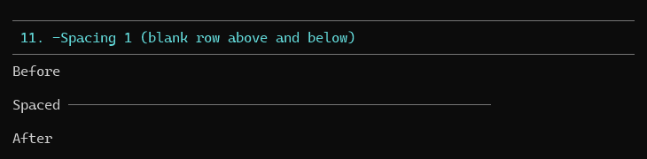

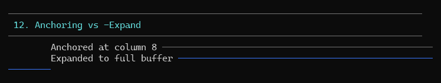

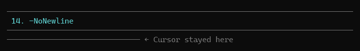
<!-- /demo-media -->

## Usage patterns

**Section heading**

```powershell
Format-AnsiRule 'Build' -Color BrightWhite -LineColor DarkGray -Spacing 1 | Out-AnsiHost
```

**Pass/fail footer**

```powershell
Format-AnsiRule ':check: 225 passed' -Markdown -Alignment Right -LineColor BrightGreen | Out-AnsiHost
```

**Indented sub-rule**

```powershell
Write-Host '    ' -NoNewline
Format-AnsiRule 'Details' -Border Dashed -LineColor DarkGray | Out-AnsiHost
```

**Plain separator**

```powershell
Format-AnsiRule -Border Dotted | Out-AnsiHost
```

<!-- demo-media -->
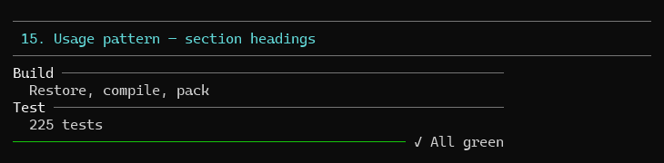

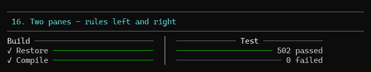
<!-- /demo-media -->

## Demo

```powershell
pwsh -File .\demo\Demo-AnsiRule.ps1
```

Numbered sections per feature: plain rule, alignment, every border, `-Char`,
`-TitlePadding`, colours, markup, markdown/emoji, `-Escape`, truncation,
`-Spacing`, anchoring vs `-Expand`, pipeline input, `-NoNewline`, section
headings, `NO_COLOR`.

<!-- demo-media -->
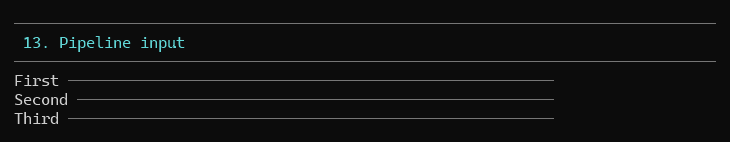

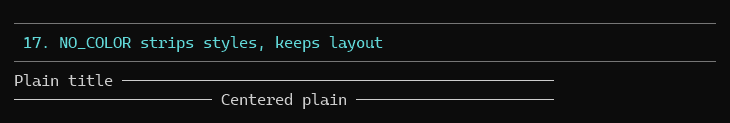
<!-- /demo-media -->

## Tests

`tests/Format-AnsiRule.Tests.ps1` — 78 Pester 5 tests covering plain lines, every
border, `-Char` tiling, title placement and padding, colours, markup/markdown
titles, truncation, `-Spacing`, anchoring, `-Expand`, pipeline input,
`-NoNewline`, the no-colour path, and parameter validation.

```powershell
pwsh -File .\Invoke-Test.ps1 -TestName '*AnsiRule*'
```
