# Invoke-AnsiTask

Runs work and reports on it while it runs: a line per step, a progress bar, or both.

```powershell
Invoke-AnsiTask 'Restoring packages' { dotnet restore }

Invoke-AnsiTask -Task @(
    @{ Name = 'Restore'; Script = { dotnet restore } }
    @{ Name = 'Build';   Script = { dotnet build -c Release } }
    @{ Name = 'Test';    Script = { dotnet test } }
)
```

```
✔ Restore  0.4s
✔ Build    2.1s
→ Test
████████████████████░░░░░░░░░░   2/3   67%
```

Unlike `Format-Ansi*`, this writes as it goes — a step that has not finished has
nothing to hand a writer. Same reason the [`Read-Ansi*`](Read-AnsiText.md) prompts
write directly. The bar it draws is [`Format-AnsiProgress`](Format-AnsiProgress.md).

## Parameters

```powershell
Invoke-AnsiTask [-Name] <string> [-ScriptBlock] <scriptblock> [options]
Invoke-AnsiTask [-Task] <object[]> [options]

options: [-Show <Both|Text|Bar>] [-ProgressShow <Percent|Count|Both|None>]
         [-Style <Blocks|Line|Dots|Ascii>] [-Width <int>]
         [-BarColor <c>] [-EmptyColor <c>] [-ContinueOnError] [-KeepBar] [-PassThru]
```

| Parameter          | Default       | Description                                            |
| ------------------ | ------------- | ------------------------------------------------------ |
| `-Name`            | required      | One step's name.                                       |
| `-ScriptBlock`     | required      | One step's work.                                       |
| `-Task`            | required      | Several steps: `@{ Name = ...; Script = { ... } }` each. |
| `-Show`            | `Both`        | Lines, bar, or both.                                    |
| `-ProgressShow`    | `Both`        | What the bar carries at its end, as [`Format-AnsiProgress -Show`](./Format-AnsiProgress.md). |
| `-Style`           | `Blocks`      | The bar's characters.                                   |
| `-Width`           | anchor        | The bar's width.                                        |
| `-BarColor`        | `BrightCyan`  | The filled part of the bar.                             |
| `-EmptyColor`      | `DarkGray`    | The remainder.                                          |
| `-ContinueOnError` | off           | Run the remaining steps after one throws.               |
| `-KeepBar`         | off           | Leave the finished bar on screen.                       |
| `-PassThru`        | off           | Emit a result object per step.                          |

A step is a hashtable or an object with `Name` and `Script` (`ScriptBlock` is
accepted too). A missing name or a `Script` that is not a scriptblock throws before
anything runs.

`$task.Update()` moves the bar inside a step, which puts a fraction in the count —
one step reporting halfway reads `0.5/1   50%`. `-ProgressShow Percent` drops the
count and leaves the percentage it was derived from:

```powershell
Invoke-AnsiTask 'Downloading' { param($task) ... } -ProgressShow Percent
```

## What a step gets

The scriptblock is called with a task control object — `param($task)`, or
`$args[0]`:

| Member            | What it does                                              |
| ----------------- | --------------------------------------------------------- |
| `$task.Name`      | The step's name.                                          |
| `$task.Index`     | Its position, zero based.                                 |
| `$task.Count`     | How many steps in this run.                               |
| `$task.Update(v, total)` | Move the bar within this step.                     |
| `$task.Write(msg)`| Print a line above the bar.                               |
| `$task.Skip(reason)` | End this step as skipped once it returns.              |
| `$task.Stop(reason)` | End the run once this step returns.                    |

```powershell
Invoke-AnsiTask 'Copying files' {
    param($task)
    $files = Get-ChildItem $source -File
    for ($i = 0; $i -lt $files.Count; $i++) {
        Copy-Item $files[$i] $destination
        $task.Update($i + 1, $files.Count)
    }
}
```

Without `Update`, the bar counts whole steps. With it, a long step fills its own
share of the bar instead of sitting still.

A `Write` line stays under its step.  
The finished line still replaces the running one above it.

<!-- demo-media -->
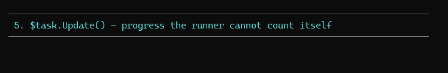

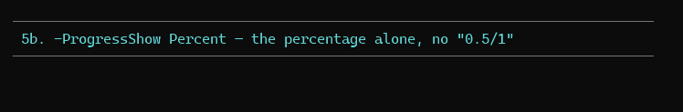

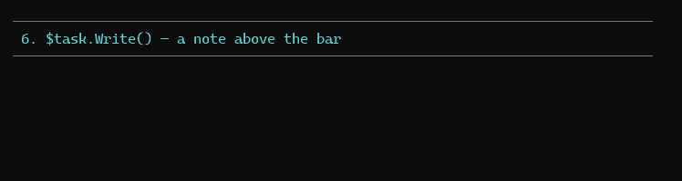
<!-- /demo-media -->

## Ending early

`Skip` and `Stop` mark the step and let it return normally.  
Neither leaves the scriptblock by itself, so `return` right after when there is nothing left to do.

```powershell
$installGit = {
    param($task)
    if (Get-Command git -ErrorAction Ignore) {
        $task.Skip('already there')
        return
    }
    winget install Git.Git
}
$installSdk = {
    param($task)
    Install-Sdk
    $task.Stop('restart needed')
}

Invoke-AnsiTask -Task @(
    @{ Name = 'Install Git'; Script = $installGit }
    @{ Name = 'Install SDK'; Script = $installSdk }
    @{ Name = 'Build'; Script = { dotnet build } }
)
```

```
· Install Git  already there
↻ Install SDK  42.0s  restart needed
```

`Skip` prints `·` with the reason and no time.  
`Stop` prints `↻` with the time and the reason, and the steps after it never run.  
A step that calls both ends the run.  
A step that throws after either one is still a failure.

<!-- demo-media -->
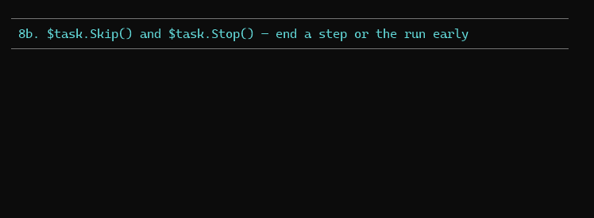
<!-- /demo-media -->

## Output and failure

The scriptblock's own output passes straight through — progress goes to the host,
not the success stream, so nothing is mixed in:

```powershell
$packages = Invoke-AnsiTask 'Querying' { Find-Module -Tag ansi }
```

A step that throws is marked `✘`, and the error is rethrown once the run stops.
`-ContinueOnError` runs the rest first. `-PassThru` emits one `PwshAnsi.TaskResult` per
step — including the steps a failure or a `Stop` prevented, so the list always matches what was
asked for:

| Property   | Meaning                                       |
| ---------- | --------------------------------------------- |
| `Name`     | The step's name.                              |
| `Ok`       | `$true` when it finished without throwing.    |
| `Status`   | `Done`, `Skipped`, `Stopped`, `Failed` or `NotRun`. |
| `Reason`   | What `Skip` or `Stop` was given, or empty.    |
| `Duration` | A `[TimeSpan]`. Never reached steps are zero. |
| `Error`    | The `ErrorRecord`, or `$null`.                |

```powershell
$results = Invoke-AnsiTask -ContinueOnError -PassThru -Task $steps
$results | Where-Object { -not $_.Ok } | ForEach-Object { $_.Error }
```

Durations print as `0.4s`, `2.1s`, `1m 05s` — invariant, so a log reads the same on
every machine.

<!-- demo-media -->
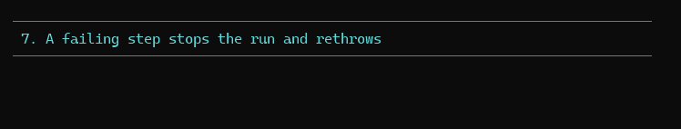

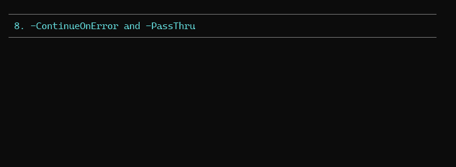
<!-- /demo-media -->

## Live terminals and logs

On a terminal, the running step is shown as `→ name` and rewritten as `✔ name 0.4s`
when it finishes, with the bar redrawn in place beneath it. The bar is cleared at the
end unless `-KeepBar`.

When output is redirected there is nothing to redraw over, so the bar is skipped and
only the finished lines print — one line per step, which is what a CI log wants.
Nothing else changes, and no parameter is needed to get it.

## Demo

```powershell
pwsh -File .\demo\Demo-AnsiTask.ps1
```

One step and many, each `-Show` mode, `$task.Update()` and `$task.Write()`, a
failing step, `-ContinueOnError` with `-PassThru` into a table, `Skip` and `Stop`,
styles and colours, and a release run end to end.

<!-- demo-media -->
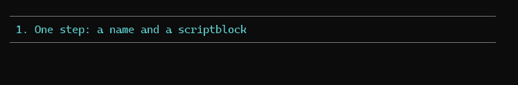

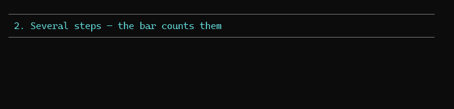

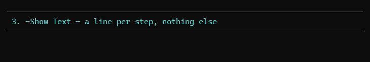

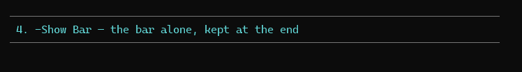

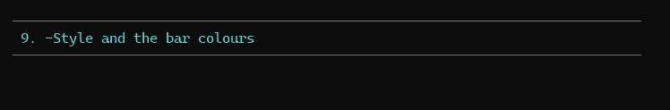

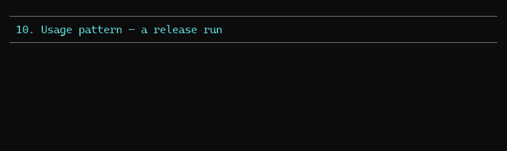
<!-- /demo-media -->

## Tests

`tests/Invoke-AnsiTask.Tests.ps1` — 41 Pester 5 tests. The liveness seam
(`Test-AnsiTaskLive`) is replaced in the module scope, so both the live redraw and
the redirected path are asserted from a redirected test run. Covers step ordering
and validation, hashtables and objects, output pass-through, failure and
`-ContinueOnError`, every `-PassThru` field, each `-Show` mode, the redraw escape
sequences, `-KeepBar`, `-Style`, `-Width`, the control object's members, and the
refusal to nest.

```powershell
pwsh -File .\Invoke-Test.ps1 -Path .\tests\Invoke-AnsiTask.Tests.ps1
```
